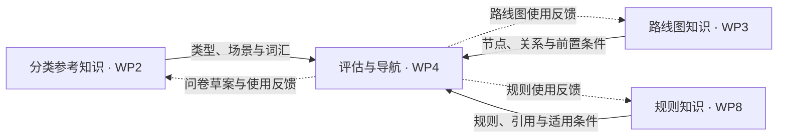

# Context Map

本索引区分仓库中的两套语言语境，并记录已确认的跨 WP 内容责任与协作关系。进一步的软件限界上下文划分属于后续设计，工作包与限界上下文分别表达。

## Contexts

- [Pathfinder 采购文档](./CONTEXT.md)：面向供应商的项目中性术语。
- [Pathfinder 跨 WP 交界](./docs/domain-modeling/pathfinder-boundaries/CONTEXT.md)：WP2/WP3/WP4/WP8 的源内容、交界约定、责任，以及机构、参与者类型和场景角色术语。

## Relationships

- 采购语言以 Approved inputs、Purchaser-provided data 等称谓描述交付给供应商的输入；跨 WP 语言保留内容来源和负责方。采购文档中的词语替换不改变内容解释权。
- WP2 向 Pathfinder 提供分类词汇，WP3 提供路线图，WP8 提供法规规则及引用；WP4 负责适配、协调和评估执行。
- [ADR 0004](./docs/adr/0004-source-wps-retain-content-authority.md)记录内容责任原则；[ADR 0005](./docs/adr/0005-v1-independent-assessment-sessions.md)记录 V1 独立评估会话范围；[ADR 0006](./docs/adr/0006-type-capabilities-remain-reference-information.md)区分类型参考能力与本次能力判断；[建模讨论记录](./docs/domain-modeling/2026-11-26-cross-wp-ddd.md)记录仍待确认的术语和边界。
- [ADR 0007](./docs/adr/0007-withdrawn-inputs-stop-new-recommendations.md)记录内容撤回与历史评估的使用边界。

## 跨 WP 内容责任与协作视图

下表按已确认的内容责任组织模型；进一步的软件限界上下文划分保留在后续设计中。

| 内容域 | 内容负责方或执行方 | 主要概念 |
| --- | --- | --- |
| 分类参考知识 | WP2 | 参与者类型、场景、能力词汇、类型参考能力 |
| 路线图知识 | WP3 | 路线图节点、关系、前置条件 |
| 规则知识 | WP8 | 项目规则、引用、适用条件 |
| 评估与导航 | WP4 | 独立评估会话、本次能力判断、核验状态、条件性方向 |

图中实线表示现有方案的知识输入关系，虚线表示既有方案的问卷评审或反馈通道；具体问卷评审责任继续细化。

职责原则、术语、实现差异和待落实事项集中见[语义治理基线](./docs/domain-modeling/2026-11-26-pathfinder-semantic-baseline.md)。用户已在第 13 问完成整体确认，本轮访谈结束；该基线作为后续设计与契约评审依据。
